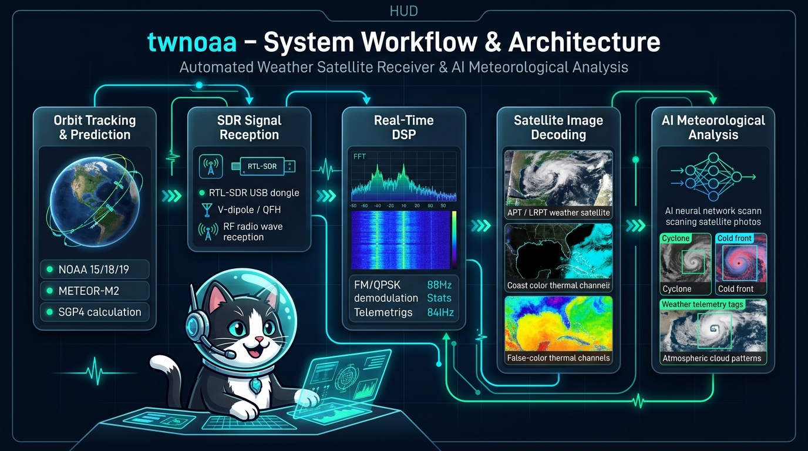
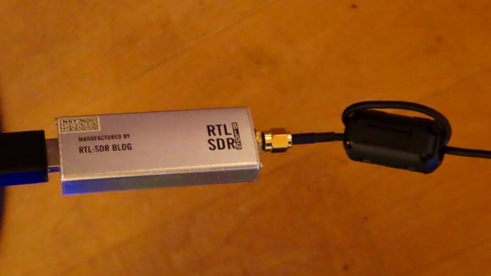
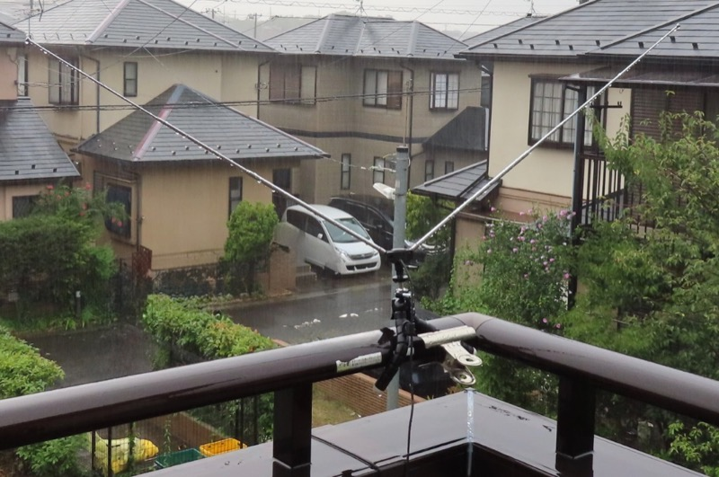
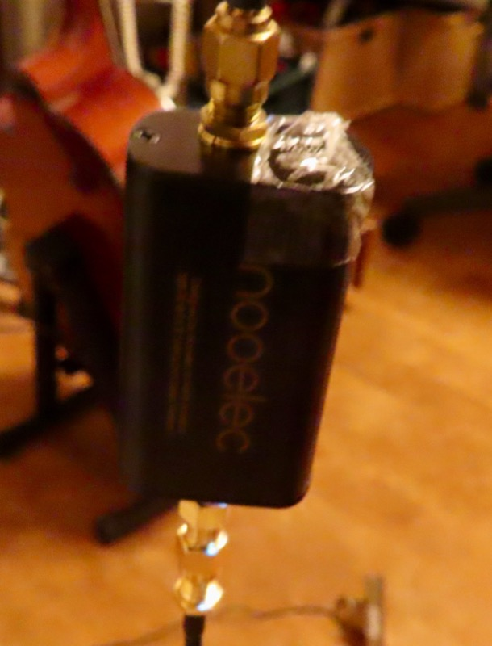
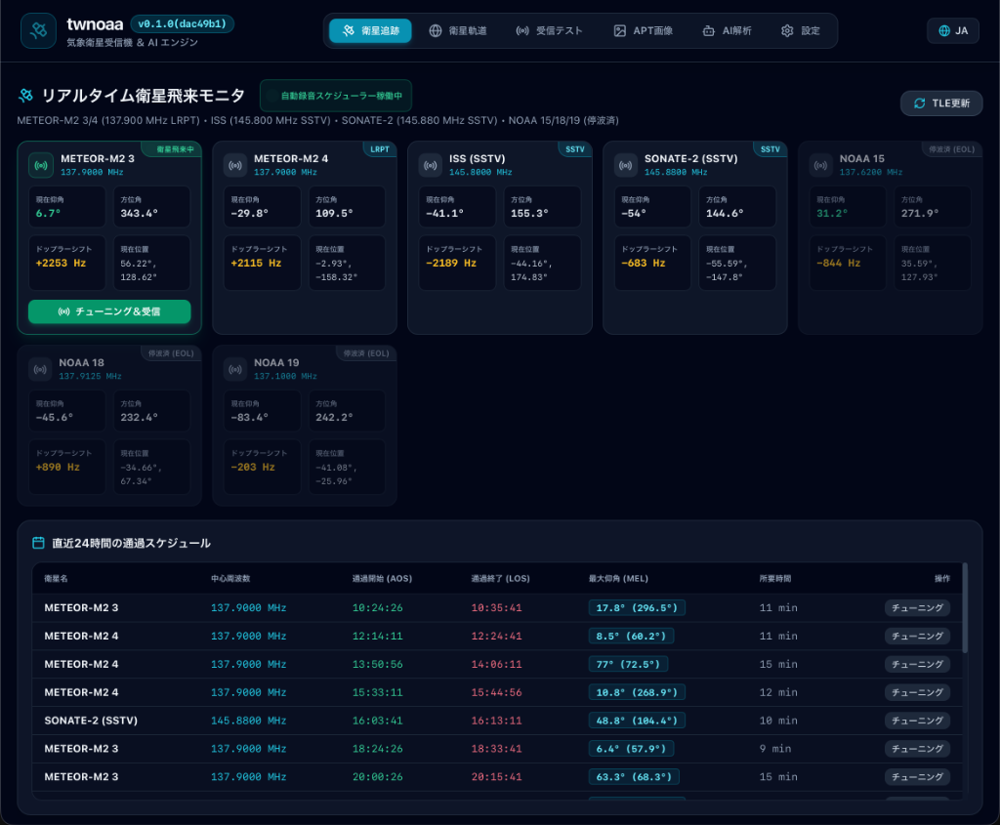
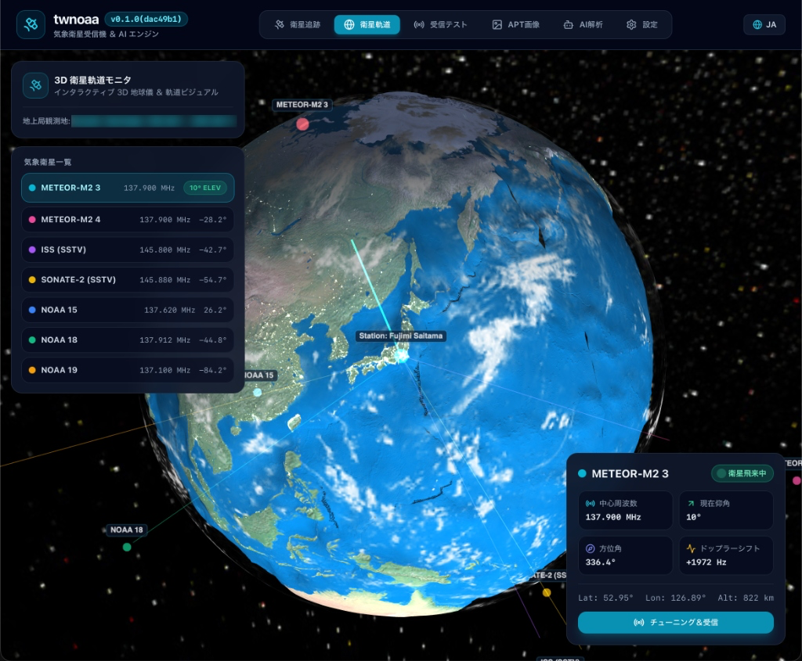
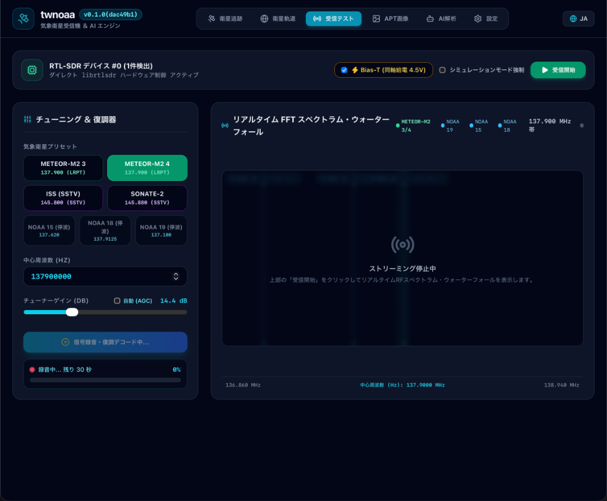
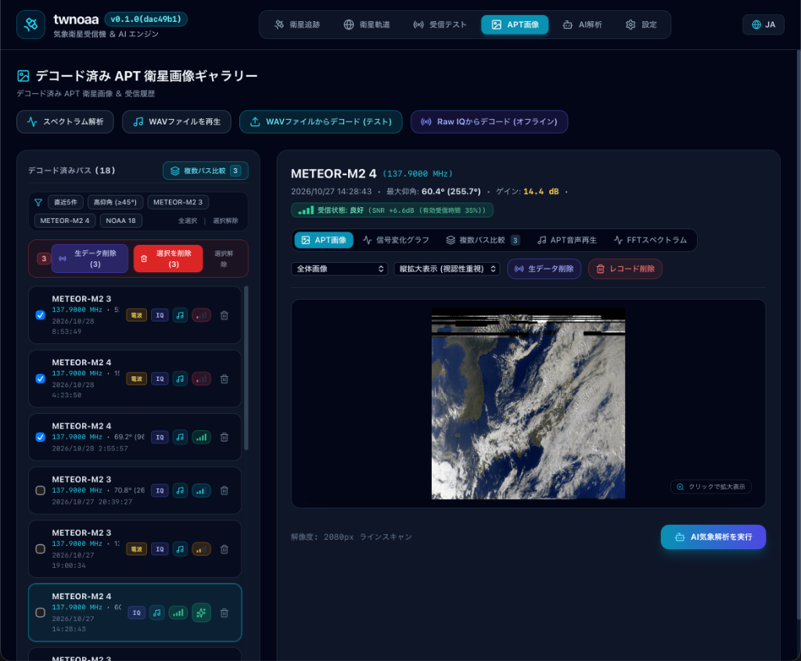
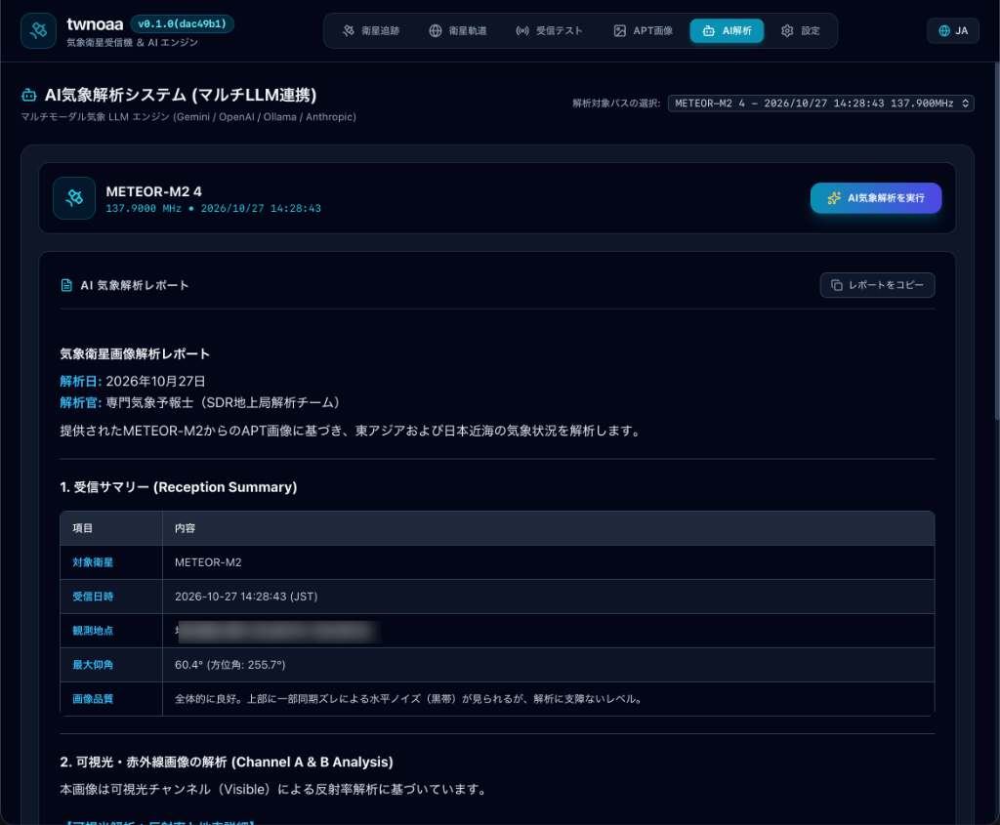
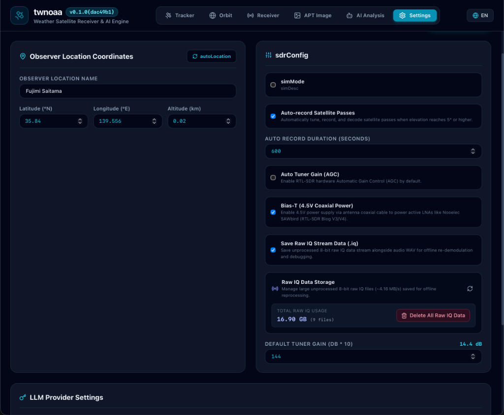

# twnoaa 📡🛰️

**twnoaa** is an all-in-one desktop application for automated weather satellite pass tracking, RTL-SDR radio reception, real-time DSP demodulation, multi-format satellite image decoding, and multimodal AI-powered meteorological analysis. Built with [Wails](https://wails.io/), [Svelte 5](https://svelte.dev/), and Go. Part of the TWSNMP project family.

> 🇯🇵 [日本語版 README はこちら](README_ja.md)

---

## 🗺️ System Workflow & Architecture



*twnoaa integrates the full satellite reception pipeline: from SGP4 Orbit Tracking to RTL-SDR signal capture, real-time DSP (FFT Spectrum & Waterfall), multi-format image decoding, and automated multimodal AI meteorological analysis.*

---

## ✨ Key Features

- 🛰️ **Automated Orbit Propagation & Pass Prediction** — Built-in pure Go SGP4 engine fetches live TLEs from CelesTrak to calculate precise visible satellite passes and auto-schedule receptions based on observer coordinates.
- 📻 **Direct RTL-SDR Control & Real-Time DSP** — Direct hardware control via `librtlsdr`, including Bias-Tee power (4.5V for active LNAs), dynamic gain tuning, and live high-speed FFT spectrum & waterfall displays.
- 🧪 **Built-in Simulation Mode** — Full workflow verification (synthetic signal generation, DSP demodulation, APT image synthesis, AI analysis) even without physical SDR hardware connected.
- 🖼️ **Multi-Protocol Satellite Decoders**
  - **NOAA APT**: FM demodulation, 2400 Hz AM subcarrier sync frame cross-correlation, dual-channel (Visible & Thermal IR) high-resolution image rendering.
  - **METEOR-M2 LRPT**: QPSK demodulation, Costas loop carrier recovery, RRC matched filtering, Viterbi & Reed-Solomon error correction for high-resolution multispectral imagery.
  - **SSTV**: ISS (International Space Station) and amateur radio space image decoding (Martin, Scottie, and other modes).
- 🤖 **AI Meteorological Insights & Cat Animation** — Passes newly decoded satellite images and reception metadata to Multimodal LLMs (Google Gemini, OpenAI, Anthropic, or local Ollama) to produce weather front, cyclone vortex, and cloud pattern analysis, accompanied by a delightful animated cat character during reasoning.
- 📼 **Raw I/Q Data Recording & Replay** — Capture live raw RF signals to disk and replay them anytime with different filter parameters or decoder algorithms.
- 💾 **Local-First Persistent Storage** — Embedded bbolt key-value database securely stores all pass records, decoded images, and AI reports completely on your local machine.
- 🌐 **Bilingual UI** — Seamless switching between English and Japanese interfaces.

---

## 🛠️ Hardware Requirements

To receive signals from orbiting weather satellites and decode high-definition imagery, the following hardware setup is recommended:

### 1. SDR Receiver (Software Defined Radio)


- **Recommended Model**: **RTL-SDR Blog V3 / V4**
- **Interface**: USB 2.0 / 3.0
- **Features**:
  - High sensitivity in the 137 MHz VHF weather satellite band.
  - **Built-in Software-Switchable Bias-Tee (4.5V DC)**: Power your active low-noise amplifier (LNA) directly through the coaxial cable with a single click in twnoaa—no external DC power injectors or extra power cables required.

### 2. Receiving Antenna


*Example of a 120° V-dipole antenna mounted on a balcony railing using a clamp fixture*

- **V-Dipole Antenna**:
  - Element length for 137 MHz: ~53.4 cm per element (~107 cm total tip-to-tip)
  - Angle: ~120° V-shape mounted horizontally
  - Cost-effective, easy to build or purchase as a kit, and highly effective for overhead satellite passes.
- **QFH Antenna (Quadrifilar Helix)**:
  - Omnidirectional circular polarization (RHCP) antenna designed specifically for polar-orbiting satellites, offering balanced reception gain from low elevation up to zenith.
- **Turnstile Antenna (Crossed Dipole)**:
  - Omnidirectional 90° phased circular-polarization antenna.

### 3. LNA (Low Noise Amplifier) & Bandpass Filter


*Nooelec SAWbird+ NOAA LNA module (inline SMA coaxial cabling, powered via Bias-Tee)*

- **Recommended Model**: **Nooelec SAWbird+ NOAA** or **RTL-SDR Blog Wideband / Filtered LNA**
- Weather satellite signals arrive from ~850 km in space with very low power. An LNA placed near the antenna provides high gain (~30 dB) with an ultra-low noise figure, while the built-in SAW filter rejects strong out-of-band interference (FM broadcast 76–108 MHz, cellular, and land mobile radios).
- **Powering**: Automatically powered via coaxial cable by turning on the Bias-Tee switch in twnoaa.

### 4. Coaxial Cable & Connectors
- 50 Ω low-loss coaxial cable (RG58, 3D-2V, LMR-195/200, etc., with SMA connectors).

---

## 📡 Antenna Installation & LNA Connection Guide

Because satellite RF signals are very faint, proper antenna placement and LNA cabling order are critical for clear, snow-free imagery.

### Antenna Placement
1. **Clear Line of Sight**:
   - Install the antenna in an open location with an unobstructed view of the sky (e.g., roof, balcony railing, or garden mast).
   - Nearby buildings, dense trees, metal fences, and power lines attenuate VHF signals and introduce sync dropouts.
2. **V-Dipole Orientation**:
   - Keep the V-shaped element plane horizontal (parallel to the ground), and orient the opening of the V pointing True North and True South (since weather satellites travel in near-polar North-South orbits).

### LNA Connection Sequence
> [!IMPORTANT]
> **Always connect the LNA directly at the antenna feedpoint (before long cable runs)!**

```
[Antenna] ──(Short jumper cable)──> [LNA Input] ──> [LNA Output] ──(Long Coax Cable)──> [RTL-SDR Dongle] ──> [Host PC]
```

- **Why place the LNA near the antenna?**
  If the LNA is placed at the indoor end of a long coaxial cable, both the attenuated satellite signal and the noise picked up along the cable run will be amplified together, resulting in poor Signal-to-Noise Ratio (SNR). Amplifying the pure, un-attenuated signal right at the antenna preserves the best possible SNR.
- **Weatherproofing**:
  Enclose outdoor LNAs in a weatherproof junction box and wrap all outdoor RF connectors with self-amalgamating waterproof tape.
- **Activating Bias-Tee**:
  Toggle the **Bias-Tee** switch to ON in twnoaa's SDR control panel to supply 4.5V DC to the LNA through the coaxial line (confirm that the LNA power LED lights up).

---

## 🖥️ User Interface & Operation Guide

twnoaa features a streamlined tabbed layout for tracking, receiving, and analyzing satellite imagery.

### 1. Pass Tracker


- **Real-Time Satellite Flyby Monitor**:
  - Displays real-time elevation, azimuth, Doppler frequency shift, and current sub-satellite coordinates (latitude/longitude) for active satellites (METEOR-M2 3/4, NOAA 15/18/19, ISS, SONATE-2).
  - Highlights currently incoming satellites with an active status badge and a "Tune & Receive" shortcut button.
- **24-Hour Upcoming Pass Schedule**:
  - Automatically fetches the latest TLE orbital data from CelesTrak (with a manual "Update TLE" option) and calculates upcoming passes with Acquisition of Signal (AOS), Loss of Signal (LOS), Maximum Elevation (MEL), and duration.
  - Clicking "Tune" automatically transfers the target frequency and demodulator settings to the SDR panel. Passes with MEL > 20° typically provide excellent reception.

### 2. 3D Globe View


- **3D Satellite Orbit Monitor**:
  - Interactive 3D Earth view rendering real-time satellite positions and orbital paths for all active weather satellites in orbit.
  - Draws a live tracking beam from your ground station to in-range satellites, helping you visualize the arrival vector of the incoming RF signal.
- **Satellite Telemetry Card**:
  - Selecting a satellite displays its center frequency, real-time elevation, azimuth, Doppler frequency shift, geographic coordinates, and flight altitude (Alt).
  - An active "Flyby Incoming" badge lights up during passes, allowing you to jump straight into reception with "Tune & Receive".

### 3. SDR Reception Test & Spectrum (SDR Control & Spectrum)


- **Hardware Control Header**:
  - Displays detected RTL-SDR status (e.g., `RTL-SDR Device #0 (1 found) Direct librtlsdr active`).
  - **Bias-T (4.5V DC)**: Power LNA amplifiers through the coaxial cable with a single toggle.
  - **Force Simulation Mode**: Run synthetic signal generation without hardware connected.
  - **Start / Stop Reception**: Toggle live streaming I/Q processing.
- **Tuning & Demodulator Panel**:
  - Weather satellite quick-select presets (METEOR-M2 3/4, ISS, SONATE-2, NOAA 15/18/19).
  - Center frequency adjustment, manual tuner gain slider, and Automatic Gain Control (AGC).
  - Recording progress bar and demodulation status indicator.
- **Real-Time FFT Spectrum & Waterfall**:
  - Overlaid satellite frequency markers (METEOR-M2 3/4, NOAA 15/18/19, etc.) for visual Doppler monitoring and signal lock.

### 4. Satellite Image Gallery (Image Gallery)


- **Decoded Pass History & Filters**:
  - Lists all received and decoded satellite passes with timestamps, frequencies, Max Elevation, SNR stats, and data badges (IQ raw signals, demodulated audio).
  - Quick filters for recent passes, high-elevation passes (≥45°), satellite models, or multi-pass comparisons.
- **High-Definition Image Viewer**:
  - Displays rendered multispectral and visible/IR satellite images. Clicking the preview launches a center-locked zoom & pan viewer for inspecting cloud vortices, frontal boundaries, and coastlines.
  - Multi-tab visualization modes: Image View, Signal SNR Chart, Multi-Pass Comparison, Audio Playback, and FFT Spectrum.
- **Offline Processing & AI Handoff**:
  - Re-demodulate and re-decode historical raw I/Q or WAV data offline anytime.
  - One-click "Run AI Weather Analysis" sends the satellite image and pass telemetry directly to multimodal LLMs.

### 5. AI Meteorological Analysis (AI Analysis)


- **Multi-LLM Weather Analysis Engine**:
  - Select any recorded satellite pass from the dropdown and click "Run AI Meteorological Analysis" to submit the decoded imagery and telemetry to multimodal models (Google Gemini, OpenAI, Ollama, or Anthropic).
  - During reasoning, an animated detective cat mascot appears in a thinking modal.
- **Structured Weather Intelligence Report**:
  - Automatically compiles a comprehensive meteorological assessment:
    - **Reception Summary**: Target satellite, timestamp, ground station location, max elevation, and image quality diagnosis.
    - **Channel A & B Analysis**: Visible reflectance, cloud top temperatures, synoptic weather fronts, cyclonic vortex rotation, and typhoon eye structures.
  - "Copy Report" button copies the markdown report directly to your clipboard with one click.

### 6. Settings


- **Observer Location Coordinates**:
  - Ground station label, latitude (°N), longitude (°E), and altitude (km).
  - One-click "autoLocation" button automatically detects station coordinates from IP address.
- **SDR Receiver Configuration (`sdrConfig`)**:
  - **Auto-record Satellite Passes**: Automatically triggers SDR tuning, reception, recording, and decoding when satellite elevation reaches 5° or higher.
  - **Bias-T (4.5V Coaxial Power)**: Supplies 4.5V DC power via antenna coaxial cable to power active LNAs like Nooelec SAWbird+ (RTL-SDR Blog V3/V4).
  - **Auto Record Duration & Gain Settings**: Configure pass duration in seconds, manual gain, or Auto Tuner Gain (AGC).
  - **Save Raw IQ Stream Data (`.iq`) & Storage**: Real-time display of total saved raw signal storage space and file count, with a "Delete All Raw IQ Data" button for easy maintenance.
- **LLM Provider Settings**:
  - Configure Google Gemini, OpenAI, Anthropic Claude, or local Ollama with API keys, models, and custom prompts.
- **UI Language**: Instant toggle between English and Japanese via the language icon in the top header.

---

## 🔍 Supported Satellites & Transmissions

| Target | Frequency | Mode / Modulation | Resolution / Details |
|---|---|---|---|
| **NOAA 15** | 137.620 MHz | APT (FM / AM 2.4 kHz Subcarrier) | 4 km/px, 2-channel (Visible & Thermal IR) |
| **NOAA 18** | 137.9125 MHz | APT (FM / AM 2.4 kHz Subcarrier) | 4 km/px, 2-channel (Visible & Thermal IR) |
| **NOAA 19** | 137.100 MHz | APT (FM / AM 2.4 kHz Subcarrier) | 4 km/px, 2-channel (Visible & Thermal IR) |
| **METEOR-M2-3/4** | 137.100 / 137.900 MHz | LRPT (72k/80k QPSK) | 1 km/px, Digital high-resolution multispectral |
| **ISS / SSTV** | 145.800 MHz | SSTV (FM / Various SSTV modes) | Space events & school contact picture transmissions |

---

## 🤖 AI Meteorological Analysis

When a satellite pass is completed and the image is decoded, the metadata (Satellite, Frequency, Timestamp, Maximum Elevation, Coordinates) is packaged with the image and submitted to the configured multimodal LLM:

- **Synoptic Weather Analysis**: Identification of low-pressure cyclonic vortices, cold/warm fronts, typhoon eye structures, and convective cloud bands.
- **Landmass & Geographic Recognition**: Detection of coastlines, peninsulas, islands, snow/ice cover, and sea surface temperature gradients.
- **Structured Markdown Report**: Clear, professional weather observations suitable for amateur radio satellite trackers.

### Supported AI Providers
- **Google Gemini** (`gemini-2.5-flash`, `gemini-1.5-pro`, etc.)
- **OpenAI** (`gpt-4o`, `gpt-4o-mini`, etc.)
- **Anthropic Claude** (`claude-3-5-sonnet`, etc.)
- **Ollama** (Local models: `llava`, `minicpm-v`, etc.)

---

## 🛠️ Tech Stack

| Component | Technology |
|---|---|
| **Desktop Framework** | [Wails v2](https://wails.io/) |
| **Backend** | Go 1.27 + CGO (`librtlsdr`) |
| **Frontend** | Svelte 5 (Runes) + TypeScript + Tailwind CSS |
| **Database** | [bbolt](https://github.com/etcd-io/bbolt) (Embedded Key-Value Store) |
| **SDR / DSP** | `github.com/jpoirier/gortlsdr`, Pure-Go DSP (WFM, QPSK, FFT, Envelope Extraction) |
| **Orbit Engine** | Pure-Go SGP4 propagation model + CelesTrak TLE client |
| **AI Integration** | `langchaingo` + Multimodal LLM providers |
| **Packaging** | macOS PKG (Apple Notarization), Windows ZIP, Linux tar.gz |

---

## 🚀 Installation & Releases

### Download Prebuilt Packages

Visit the [Releases](https://github.com/twsnmp/twnoaa/releases) page to get binaries for your operating system:

- **macOS (Apple Silicon)**: Download `twnoaa-v0.1.0-darwin-arm64.pkg` and run the signed installer (notarized by Apple).
- **Windows (x64)**: Download `twnoaa-windows-amd64.zip`, extract to any directory, and run `twnoaa.exe` (includes required `rtlsdr.dll`).
- **Linux (x64)**: Download `twnoaa-linux-amd64.tar.gz`, extract and run (requires `librtlsdr0`, `libwebkit2gtk-4.1-0`).

---

## 💻 Development Setup

### Prerequisites

- [mise](https://mise.jdx.dev/) (Toolchain manager for Go and Node.js)
- [Wails CLI v2.15+](https://wails.io/docs/gettingstarted/installation)
- RTL-SDR library (`librtlsdr`):
  - macOS: `brew install librtlsdr`
  - Ubuntu/Debian: `sudo apt-get install -y librtlsdr-dev libgtk-3-dev libwebkit2gtk-4.1-dev`
  - Windows: prebuilt 64-bit DLL & headers

### Setup Dependencies

```bash
# Install Go and Node via mise
mise install

# Install frontend dependencies
cd frontend
npm install
cd ..
```

### Live Development Mode

```bash
mise run dev
# or
wails dev
```

### Production Build

```bash
# Local build
mise run build

# macOS signed and notarized installer package (.pkg)
mise run release-mac
```

---

## 🗄️ Data Directories

Configuration, pass logs, decoded images, and the bbolt database are stored locally in the following OS directories:

| Platform | Default Path |
|---|---|
| **macOS** | `~/Library/Application Support/twnoaa/` |
| **Windows** | `%APPDATA%\twnoaa\` |
| **Linux** | `~/.config/twnoaa/` |

---

## 📄 License

[Apache License 2.0](LICENSE)
