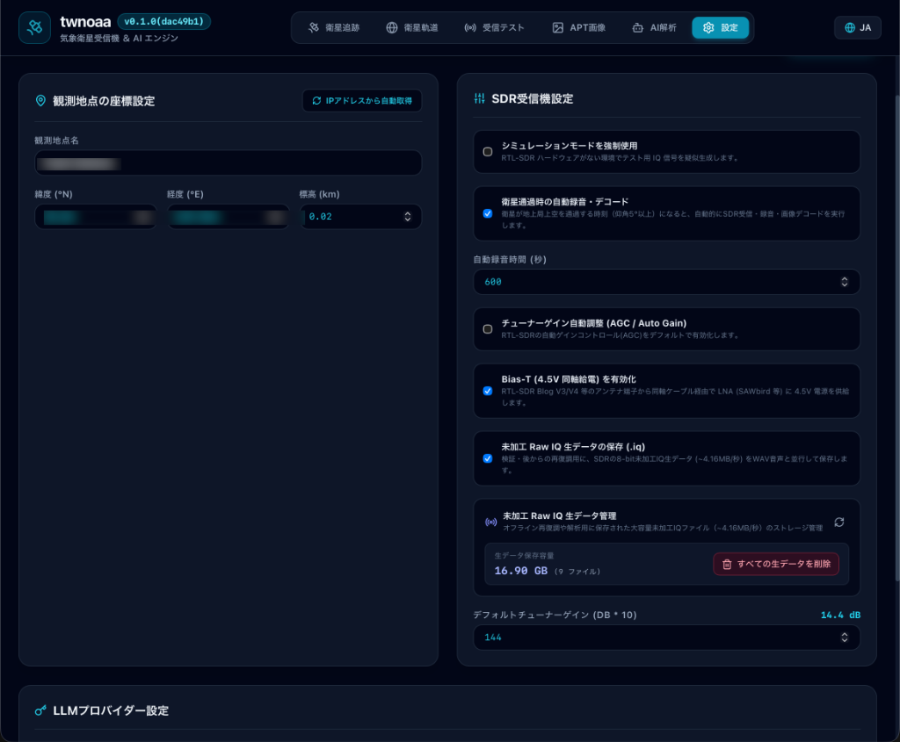

# twnoaa 📡🛰️

**twnoaa** は、気象衛星（NOAA 15/18/19、METEOR-M2シリーズ）や宇宙通信（SSTV/ISS）の軌道計算・通過予測、RTL-SDRによる自動受信、リアルタイムDSP復調、衛星画像デコード、およびマルチモーダルAIによる気象画像解析を統合したオールインワンのデスクトップアプリケーションです。[Wails](https://wails.io/) と [Svelte 5](https://svelte.dev/)、Go で構築されており、TWSNMPシリーズプロジェクトの一つです。

> 🇬🇧 [English README](README.md)

---

## 🗺️ システム構成・ワークフロー


*twnoaa は、衛星の軌道計算（Orbit Tracking）から RTL-SDR による電波受信、リアルタイムDSP処理（スペクトラム＆ウォーターフォール）、衛星画像デコード、そしてマルチモーダルAIによる気象解析までの全パイプラインを統合したデスクトップアプリケーションです。*

---

## ✨ 主な特徴

- 🛰️ **自動軌道計算 & 通過予測** — 内蔵SGP4軌道計算エンジンにより、CelesTrakから最新TLEを自動取得して衛星の可視通過（パス）を正確に予測・自動スケジューリング
- 📻 **RTL-SDR 直接制御 & リアルタイムDSP** — RTL-SDR（`librtlsdr`）を直接制御し、Bias-Tee給電（4.5V）やゲイン調整、リアルタイムのFFTスペクトラム＆ウォーターフォール表示に対応
- 🧪 **内蔵シミュレーションモード** — RTL-SDRハードウェアが手元にない場合でも、模擬信号生成により受信・復調・AI解析の全ワークフローをすぐに体験可能
- 🖼️ **多彩な衛星デコーダー対応**
  - **NOAA APT**: FM復調・2400Hz副搬送波検波・フレーム同期相関処理による可視光/赤外線画像合成
  - **METEOR-M2 LRPT**: QPSK復調、Viterbi＆Reed-Solomon誤り訂正による高精細マルチスペクトルデジタル衛星画像
  - **SSTV**: ISS（国際宇宙ステーション）やアマチュア無線からの宇宙画像デコード（Martin, Scottie等）
- 🤖 **AI気象解析 & 猫アニメーション** — 復調された衛星画像をGemini、OpenAI、Anthropic、ローカルOllamaなどのマルチモーダルAIに連携し、前線・低気圧渦・雲パターンの自動気象分析レポートを生成（思考中の猫アニメーションつき）
- 📼 **Rawデータ（I/Q信号）録音 & リプレイ** — 受信した生信号をローカルに保存し、後から何度でもリプレイして再デコードやアルゴリズム検証が可能
- 💾 **完全ローカル永続化** — 組み込みKey-Valueストア（bbolt）により、受信履歴、衛星画像、AI解析レポートを完全ローカル管理
- 🌐 **二言語UI対応** — 日本語と英語の表示切替に対応

---

## 🛠️ 必要な機材 (Hardware Requirements)

気象衛星の信号を受信して鮮明な衛星画像をデコードするために必要なハードウェア構成です。

### 1. SDR 受信機 (Software Defined Radio)


- **推奨モデル**: **RTL-SDR Blog V3 / V4**
- **接続インターフェース**: USB 2.0 / 3.0
- **特徴**:
  - 気象衛星の 137MHz 帯 VHF 電波を高感度に受信可能。
  - **内蔵 Bias-Tee（ソフトウェア制御による 4.5V 直流給電機能）** を搭載。twnoaa の画面上のスイッチを ON にするだけで、同軸ケーブルを経由してアンテナ直下に配置したアクティブ LNA へ電源を直接供給できます（外部電源アダプタや給電インジェクタが不要）。

### 2. 受信アンテナ


*ベランダの手すりにクランプマウントで設置された 120° Vダイポールアンテナの例*

- **Vダイポールアンテナ (V-Dipole)**:
  - 137MHz 帯向けエレメント長: 片側 約 53.4 cm（全長 約 107 cm）
  - 開き角: 水平面に対して約 120 度の V 字型
  - 初心者でも安価に自作またはキットで購入可能。上空を飛行する衛星からの電波を効率的に捉えることができます。
- **QFHアンテナ (Quadrifilar Helix)**:
  - 気象衛星が送信する右旋円偏波（RHCP）に最適化された 3D ヘリカル構造のアンテナ。全方位に均一な利得を持ち、低仰角から天頂まで安定した受信が可能です。
- **ターンスタイルアンテナ (Turnstile / 交叉ダイポール)**:
  - 90 度位相給電による無指向性円偏波アンテナ。

### 3. LNA (低雑音増幅器) ＆ バンドパスフィルタ
- **推奨モデル**: **Nooelec SAWbird+ NOAA** または **RTL-SDR Blog Wideband / Filtered LNA**
- 気象衛星からの電波は宇宙（高度約 850 km）から届く微弱な信号です。アンテナ直下で信号を強力に増幅（利得約 30dB）するとともに、SAW フィルタによって FM 放送（76-108MHz）や携帯電話・業務無線などの強力な混信ノイズを急峻に遮断します。
- **電源供給**: twnoaa の Bias-Tee 機能を有効にすることで、同軸ケーブル経由で自動給電されます。

### 4. 同軸ケーブル & コネクタ
- 50Ω 低損失同軸ケーブル（RG58, 3D-2V, LMR-195/200 等、SMAコネクタ付き）。

---

## 📡 アンテナの設置方法と LNA 接続ガイド

微弱な衛星信号からノイズのない鮮明な衛星画像を得るためには、**アンテナの設置場所** と **LNA の接続順序** が極めて重要です。

### アンテナの設置環境
1. **見晴らしの確保**:
   - 屋上、ベランダの手すり、庭のポールなど、上空および南北・東西方向の視界が広く開けた場所に設置してください。
   - 周囲の建物、樹木、金属フェンス、電線などの遮蔽物は電波を減衰させ、画像のスノーノイズやライン抜けの原因になります。
2. **アンテナの向き（Vダイポールの場合）**:
   - V字のエレメントが広がる水平面を地上と平行にし、V字の開口部が「真南および真北」を向くように設置します（極軌道衛星は概ね南北方向に飛行するため）。

### LNA（低雑音増幅器）の接続順序
> [!IMPORTANT]
> **LNA は必ずアンテナの直近（アンテナ直下）に接続してください！**

```
[アンテナ] ──(数cm〜短尺ケーブル)──> [LNA Input] ──> [LNA Output] ──(長い同軸ケーブル)──> [RTL-SDR ドングル] ──> [PC]
```

- **なぜアンテナ直下に置くのか？**
  同軸ケーブルを通過した後に LNA を設置すると、ケーブル内で減衰してしまった微弱信号と、ケーブルで拾った都市雑音の両方を増幅してしまい、SNR（信号対雑音比）が改善しません。アンテナで拾った最もピュアな微弱信号を、減衰する前にその場で増幅するのが最大のポイントです。
- **屋外防水**:
  屋外に設置する LNA は、密閉ケース（防水ボックスやタッパー）に収め、コネクタ部に自己融着テープを巻いて雨水の浸入を防いでください。
- **Bias-Tee の有効化**:
  twnoaa の「SDR受信」画面にある **Bias-Tee** スイッチを ON にすると、同軸ケーブルを通じて LNA へ 4.5V が送電され、LNA 基板の通電 LED が点灯します。

---

## 🖥️ 画面と操作方法

twnoaa は、直感的なタブ切り替えインターフェースで衛星追跡から画像解析までシームレスに操作できます。

### 1. 衛星追跡画面 (Pass Tracker)


- CelesTrak から最新 TLE を自動取得し、現在地から観測可能な衛星（NOAA 15/18/19, METEOR-M2-x）の通過スケジュールを一覧表示します。
- **表示項目**: 衛星名、周波数、通過開始（AOS）、最大仰角（Max Elevation）、通過終了（LOS）、カウントダウン。
- **操作**: リストの「受信準備」ボタンをクリックすると、選択した衛星の周波数と変調モードが自動的に SDR 画面にセットされます。最大仰角が 20° 以上のパスが良好な受信に適しています。

### 2. 3D 地球儀画面 (Globe View)


- 宇宙空間から見た 3D 地球儀上に、衛星の現在位置、軌道パス、および電波受信エリア（フットプリント）をリアルタイムで描画します。
- 自宅の観測ポイントが衛星のフットプリントに入ると電波が届き始めます。

### 3. SDR 受信 & DSP 復調画面 (SDR Control & Spectrum)


- **SDR コントロール**: 周波数調整、チューナーゲイン設定、Bias-Tee（4.5V給電）の ON/OFF、生信号録音（Raw I/Q）トグル。
- **シミュレーションモード**: SDR ドングルを接続していない場合でも、模擬信号を内部生成して受信・復調・AI 解析の全プロセスをテスト可能。
- **高速 FFT スペクトラム & ウォーターフォール**: 受信信号のキャリアと帯域、ドップラーシフトによる周波数変化を視覚的に監視できます。
- **デコードプレビュー**: 信号を受信すると、APT（走査線画像）や LRPT、SSTV の画像がリアルタイムにデコード描画されます。

### 4. 画像ギャラリー画面 (Image Gallery)


- 受信・デコードが完了した過去の衛星画像をグリッド一覧表示。
- **拡大ビューアー**: クリックで高解像度ビューアーが開き、中心固定ズームとパンで台風の目や海岸線、雲のテクスチャを詳細に観察できます。
- **Raw リプレイ**: Raw 録音データがある場合、異なるパラメータで何度でも再デコード可能。

### 5. AI 気象解析画面 (AI Analysis)


- ギャラリーで選択した衛星画像と通過メタデータをマルチモーダル LLM へ送信し、気象分析を実行します。
- **猫アニメーション**: AI 解析中は、探偵猫キャラクターが思考中アニメーションモーダルで進行状況をお知らせします。
- **解析レポート**: 低気圧の渦、前線の位置、台風の構造、積乱雲の発達状況、主要な地形ランドマークを日本語マークダウンで出力。

### 6. 環境設定画面 (Settings)


- **観測地点設定**: 緯度・経度・標高（IP によるワンクリック自動取得ボタン付き）。
- **AI プロバイダー設定**: Google Gemini / OpenAI / Anthropic Claude / ローカル Ollama の選択、API キー入力、モデル指定。
- **UI 言語切替**: 日本語 / 英語の切り替え。

---

## 🔍 サポートする衛星・モード

| 衛星・通信 | 周波数 | 変調・モード | 解像度・特徴 |
|---|---|---|---|
| **NOAA 15** | 137.620 MHz | APT (FM / AM 2.4kHz Subcarrier) | 4 km/px, 可視光 & 熱赤外線 2チャンネル画像 |
| **NOAA 18** | 137.9125 MHz | APT (FM / AM 2.4kHz Subcarrier) | 4 km/px, 可視光 & 熱赤外線 2チャンネル画像 |
| **NOAA 19** | 137.100 MHz | APT (FM / AM 2.4kHz Subcarrier) | 4 km/px, 可視光 & 熱赤外線 2チャンネル画像 |
| **METEOR-M2-3/4** | 137.100 / 137.900 MHz | LRPT (72k/80k QPSK) | 1 km/px, デジタル高解像度マルチスペクトル画像 |
| **ISS / SSTV** | 145.800 MHz | SSTV (FM / 各種SSTVモード) | 国際宇宙ステーションからのイベント宇宙通信画像 |

---

## 🤖 AI連携による気象解析

衛星画像がデコードされると、受信メタデータ（衛星名、周波数、通過時刻、最大仰角、受信地座標）とともにマルチモーダルLLMへ自動送信され、以下のような分析が自動生成されます：

- **気象パターンの識別**: 温帯低気圧の渦、寒冷前線・温暖前線、台風の目、積乱雲群の特定
- **地形・ランドマークの認識**: 海岸線、島嶼、半島、雪氷域、海流境界の検出
- **日本語による専門的考察**: アマチュア衛星観測者向けの分かりやすく詳細な気象レポート

### 対応AIプロバイダー
- **Google Gemini**（`gemini-2.5-flash`, `gemini-1.5-pro` など）
- **OpenAI**（`gpt-4o`, `gpt-4o-mini` など）
- **Anthropic Claude**（`claude-3-5-sonnet` など）
- **Ollama**（ローカル動作: `llava`, `minicpm-v` など）

---

## 🛠️ 技術スタック

| コンポーネント | 採用技術 |
|---|---|
| **デスクトップ基盤** | [Wails v2](https://wails.io/) |
| **バックエンド** | Go 1.27 + CGO (`librtlsdr`) |
| **フロントエンド** | Svelte 5 (Runes) + TypeScript + Tailwind CSS |
| **データベース** | [bbolt](https://github.com/etcd-io/bbolt)（組み込みKey-Valueストア） |
| **SDR / DSP** | `github.com/jpoirier/gortlsdr`, ピュアGo DSPエンジン（WFM, QPSK, FFT, I/Q） |
| **軌道計算** | ピュアGo SGP4 伝搬モデル + CelesTrak TLE パーサー |
| **AIオーケストレーション** | `langchaingo` + 各種LLM APIクライアント |
| **パッケージング** | macOS PKG (Apple Notarization 公証対応), Windows ZIP, Linux tar.gz |

---

## 🚀 インストールと起動

### 配布パッケージの利用

[Releases](https://github.com/twsnmp/twnoaa/releases) より、お使いのOSに合ったパッケージをダウンロードしてください。

- **macOS (Apple Silicon)**: `twnoaa-v0.1.0-darwin-arm64.pkg` をダウンロードし、インストーラーを実行してください（Apple公証済み）。
- **Windows (x64)**: `twnoaa-windows-amd64.zip` をダウンロードし、任意のフォルダに展開して `twnoaa.exe` を実行してください（必要な `rtlsdr.dll` 同梱）。
- **Linux (x64)**: `twnoaa-linux-amd64.tar.gz` を展開して実行してください（要 `librtlsdr0`, `libwebkit2gtk-4.1-0`）。

---

## 💻 開発環境のセットアップ

### 前提条件

- [mise](https://mise.jdx.dev/)（Go、Node.js の管理）
- [Wails CLI v2.15+](https://wails.io/docs/gettingstarted/installation)
- RTL-SDR ライブラリ (`librtlsdr`):
  - macOS: `brew install librtlsdr`
  - Ubuntu/Debian: `sudo apt-get install -y librtlsdr-dev libgtk-3-dev libwebkit2gtk-4.1-dev`
  - Windows: prebuilt 64bit DLL & headers

### 依存関係のセットアップ

```bash
# ツールチェーンのインストール
mise install

# フロントエンドの依存関係インストール
cd frontend
npm install
cd ..
```

### 開発モード起動 (ホットリロード)

```bash
# 開発サーバー起動
mise run dev
# または
wails dev
```

### ビルド

```bash
# ローカルビルド
mise run build

# macOS 公証インストーラーパッケージ作成 (Developer ID & notarytool)
mise run release-mac
```

---

## 🗄️ データ保存場所

受信データ、ログ、衛星画像、および bbolt データベースファイルは以下のディレクトリに保存されます。

| OS | デフォルトパス |
|---|---|
| **macOS** | `~/Library/Application Support/twnoaa/` |
| **Windows** | `%APPDATA%\twnoaa\` |
| **Linux** | `~/.config/twnoaa/` |

---

## 📄 ライセンス

[Apache License 2.0](LICENSE)
